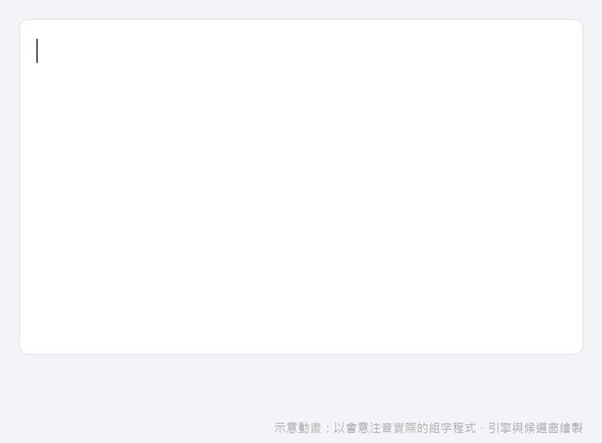

**會意注音** 是給 Windows 用的注音輸入法：按錯鍵也能猜出你想打的字。辨識模型在你的電腦上執行，可以離線使用，打的字不會上傳。

**Huiyi** is a Zhuyin (Bopomofo) input method for Windows that reads through typos. The model runs on your PC, offline; nothing you type leaves it.

> 會意注音是以 [AquaType](https://github.com/dio7153/AquaType)（Dio Hsieh，Mac 版）為基礎的獨立 Windows 版本，不是 AquaType 作者製作或背書的。辨識模型沿用 AquaType 的模型（CC BY-NC 4.0），**只限個人、非商業使用**。
>
> Huiyi is an independent Windows build based on [AquaType](https://github.com/dio7153/AquaType) by Dio Hsieh; it is not made or endorsed by the AquaType author. It uses AquaType's model (CC BY-NC 4.0): **personal, non-commercial use only**.



<sub>示意動畫：由 `windows/tip/tsf/demo_render.cpp` 讓實際的組字程式接真的引擎照腳本打字，候選窗用輸入法本身的繪圖程式畫出，再由 `windows/tools/demo_compose.py` 合成。</sub>

## 功能

- **打錯也讀得懂**：相鄰鍵按錯、漏打、多打，照樣列出正確的字句（AquaType 的雜訊通道解碼，在 CPU 上執行；支援 AVX2，舊電腦自動改用 SSE）。
- **整句直出**（預設開啟）：組字區直接顯示整句；按 ← → 回到某個字，按 ↓ 叫出選單改選。
- **發音容錯**：ㄣ／ㄥ、ㄢ／ㄤ、捲舌不分也找得到（例如「因該」→「應該」），每一組都可以關掉。
- 單按 Shift 切換中／英；聲母加空白鍵直接打出注音符號；候選字最後附上注音本身。
- **個人記憶**：記住你選過的字，只存在自己的電腦（`%USERPROFILE%\.huiyi`），設定裡可以一鍵清除。
- 設定：在工作列「中／英」按右鍵、Windows 設定裡的「選項」，或開始功能表的「會意注音 設定」。

## 安裝

需要 Windows 11、64 位元（x64）。32 位元的應用程式也能使用。Windows 10 尚未測試。

1. 到 [Releases](../../releases) 下載 `Huiyi-<版本>-win-x64.zip`，解壓縮。
2. 用**系統管理員身分**開啟 PowerShell，切到解壓縮的資料夾，執行：
   ```powershell
   powershell -ExecutionPolicy Bypass -File .\install.ps1
   ```
3. 按 Win＋Space 選「會意注音」。已經開著的程式要重新開啟才會出現。

移除：用系統管理員身分執行
```powershell
powershell -ExecutionPolicy Bypass -File "C:\Program Files\Huiyi\uninstall.ps1"
```
個人記憶會保留；要一起刪除，刪掉 `%USERPROFILE%\.huiyi` 資料夾。

## 按鍵操作

鍵盤排列是標準（大千）注音，操作大多比照微軟注音。

| 按鍵 | 作用 |
|---|---|
| 空白 | 一聲；聲調打完後再按，送出整句 |
| Enter | 送出整句（選單開著時：選字） |
| Esc | 清除正在打的字（選單開著時：關閉選單） |
| ← → ／ Home End | 在整句裡移到某個字 |
| ↓ | 打開這個字的選單；選單裡 ↑ ↓ 移動、PgUp PgDn 翻頁、1–9／Enter／空白選字 |
| Backspace | 刪掉最後一個注音；游標在句中時刪掉游標前的字 |
| 單按 Shift | 切換中／英（可在設定裡關掉） |
| Ctrl＋空白 | Windows 內建：整個開／關中文輸入法（關閉時打英文，工作列顯示「英」）；關閉時單按 Shift 會重新打開 |
| Shift＋字母 | 打大寫英文，不切換模式 |
| 聲母＋空白 | 直接打出注音符號（ㄅ 空白 → ㄅ） |
| Shift＋，／Shift＋． | ，／。 |
| \[ \] ／ Shift＋\[ \] | 「」／『』 |
| \\ | 、 |
| 工作列的「中／英」 | 左鍵切換；右鍵選單：切換、設定… |

## 設定選單

在工作列「中／英」按右鍵 →「設定…」，或 Windows 設定 → 時間與語言 → 語言 → 中文（台灣）→ 鍵盤 → 會意注音 →「選項」，或開始功能表的「會意注音 設定」。

| 分類 | 項目 | 預設 |
|---|---|---|
| 輸入方式 | 整句直出（直接顯示整句；← → 回到某個字，↓ 改選） | 開 |
| 按鍵 | 單按 Shift 切換中／英 | 開 |
| | CapsLock 開著時打英文（不勾：CapsLock 不影響注音） | 關 |
| 注音 | 聲母加空白鍵直接打出注音符號 | 開 |
| | 候選字最後附上注音本身（「注」） | 開 |
| 發音容錯與選字 | ㄣ／ㄥ 不分（因該 → 應該） | 開 |
| | ㄢ／ㄤ 不分 | 開 |
| | 捲舌不分（ㄓㄗ、ㄔㄘ、ㄕㄙ） | 開 |
| | 常用詞優先 | 開 |
| 外觀 | 候選字大小（小／中／大） | 中 |
| 個人記憶 | 清除個人記憶（會先確認，無法復原） | — |

按「套用」或「確定」後立刻生效，不用重開程式。

## 跟 AquaType 的差異

AquaType 是 Mac 版（Apple Silicon、Metal／MLX，前端是鼠鬚管 Squirrel／RIME）。會意注音沿用它的**模型、字典與解碼方法**，把它帶到 Windows，並在這個基礎上多做了這些：

**移植到 Windows**
- **解碼器的 CPU 後端**（`decoder/native/cpu`，約 1,200 行）：不需要 GPU；自動判斷 CPU，支援 AVX2，舊電腦改用 SSE；權重用 int8／4-bit 運算，排名結果與原本一致。
- **引擎**改寫成 C++（`windows/engine`，對應 AquaType 的 Swift 引擎），沿用同一套請求格式、字典格式與個人記憶格式。
- **輸入法本體從頭寫成 Windows 的 TSF text service**（不經過 RIME）：組字、候選窗、工作列中／英圖示（跟著深淺色主題）、64 與 32 位元程式都能用。

**新增的功能**
- **發音容錯**：原本的容錯只考慮鍵盤上相鄰的鍵按錯；台灣口音常見的 ㄣ／ㄥ、ㄢ／ㄤ、捲舌不分（例如「因該」→「應該」）不在鍵盤錯誤裡，原本找不到。現在把這幾組讀音視為可互換，並對字典裡的詞加權。我們的評測裡，發音混淆的整句第一名正確率從 59.5% 提高到 90.5%，一般句子（打對或打錯 10%）的結果不變。
- **整句直出**與回頭改選：組字區直接顯示整句；← → 移到某個字、↓ 叫出選單改選，改過的字會固定住。
- **設定視窗**：發音容錯分組開關、字典優先、候選字大小、Shift／CapsLock 行為、清除個人記憶。
- 聲母加空白直接打出注音符號；候選字最後附上注音本身（「注」）。

**速度與穩定**
- 每個按鍵的處理時間在開發機上從約 211 ms 降到約 55 ms，第一名的正確率持平或更好。
- 電腦同時跑其他重的程式時，最慢的按鍵原本要等到約 8.8 秒，現在約 0.15 秒（解碼器的運算執行緒等待時改成休眠，不再空轉搶 CPU）。
- 修正輸入法關閉或切換時，跟引擎的連線偶爾卡死的問題。
- `composer_test`：22 個案例接真的引擎，測按鍵行為（整句直出、改選、Shift、標點…）。

`decoder/native` 裡的改動（CPU 後端、發音容錯）都依 Apache-2.0 釋出；AquaType 若想採用，歡迎直接取用。

## 使用建議

- **整句打完再修改**：整句直出會邊打邊用後文修正前面的字，先打完再用 ← → 回去、按 ↓ 改選，比逐字選快。
- **發音容錯**不需要的話，可以在設定裡個別關掉（ㄣ／ㄥ、ㄢ／ㄤ、捲舌），候選字會比較精準。
- **第一次使用會比較慢**：引擎第一次啟動要載入模型；剛安裝時防毒軟體掃描新程式，可能要等幾十秒。之後每次登入會自動在背景啟動。
- **輸入法清單裡沒出現**：已經開著的程式要重開；還是沒有就登出再登入。
- **個人記憶**選錯了想重來：設定 →「清除個人記憶」。
- 只想打注音符號：聲母後按空白鍵（例如ㄅ＋空白），或在候選字最後一組「注」裡選。

## 已知限制與尚未完成

會意注音目前是第一版（0.x），下面這些還沒做或還沒驗證，歡迎回報或一起做：

| 狀態 | 項目 |
|---|---|
| 尚未測試 | Windows 10；ARM64 版 Windows（目前只有 x64）；以系統管理員身分執行的程式、全螢幕遊戲 |
| 尚未完成 | 安裝程式只是 PowerShell 腳本，沒有 MSI；執行檔沒有數位簽章，下載時 Windows 可能會警告；沒有自動更新 |
| 研究中 | 中英混打；下一個字的預測（聯想詞） |
| 已知 | 字表每個字只收一個讀音，多音字在備援候選裡可能找不到少用的讀音；移除後若有程式還在使用，要登出才刪得乾淨 |
| 授權 | 模型為 CC BY-NC 4.0，所以會意注音不能用於商業用途 |

## 回報問題與建議

請到 [Issues](../../issues) 開新的 issue，並選對應的表單：

- **問題回報**：請附上 Windows 版本、在哪個程式裡發生、按了哪些鍵、預期與實際的結果。
- **功能建議**：說明想做什麼、現在卡在哪裡。

引擎記錄在 `%LOCALAPPDATA%\Huiyi\engine.log`，只記狀態和錯誤，**不會記你打的字**。不過記錄裡的路徑會帶出 Windows 使用者名稱，貼上前請看一下。

## 參與開發

歡迎提 PR。修改前請先看 [CONTRIBUTING.md](CONTRIBUTING.md)：建置方式、測試、程式風格，以及各部分的授權（你貢獻的程式碼會依所在目錄的授權釋出）。

## 從原始碼建置

需要 Visual Studio 2022 以上的 C++ 建置工具（含 CMake、Ninja）。

```powershell
# 模型權重等大檔不放在 git 裡，從 release 取回並核對 SHA256
powershell -File windows\install\restore_payload.ps1 -Release v0.1.0

# 64 位元（在 x64 Native Tools 命令提示字元裡）
cmake -S windows -B windows\build -G Ninja -DCMAKE_BUILD_TYPE=Release
cmake --build windows\build
# 32 位元輸入法 DLL，給 32 位元的程式用（在 x86 Native Tools 命令提示字元裡）
cmake -S windows -B windows\build32 -G Ninja -DCMAKE_BUILD_TYPE=Release -DAQ_TIP_ONLY=ON
cmake --build windows\build32 --target HuiyiTSF

# 測試：輸入法的按鍵狀態機，接真的引擎
windows\build\composer_test.exe windows\build\HuiyiEngine.exe packaging\payload data\char_to_keys.json

# 打包成安裝資料夾 dist\Huiyi-win
powershell -File windows\install\stage.ps1
```

## 架構

- `windows/tip`：輸入法本體（TSF text service，`HuiyiTSF.dll`）與組字狀態機（`composer.cpp`）。
- `windows/engine`：解碼引擎（`HuiyiEngine.exe`），輸入法透過 named pipe 跟它溝通。
- `windows/settings`：設定視窗（`HuiyiSettings.exe`）。
- `decoder/native`：AquaType 的解碼器，`cpu/` 是 Windows 用的 CPU 後端。
- `packaging/payload`：模型與字典（大檔由 release 取回）。

## 授權

各部分授權不同，詳見 [windows/NOTICE-Huiyi.txt](windows/NOTICE-Huiyi.txt) 與 [NOTICE.txt](NOTICE.txt)：

| 部分 | 授權 |
|---|---|
| 輸入法前端與設定視窗（`windows/tip`、`windows/settings`） | GPL-3.0 |
| 引擎與解碼器（`windows/engine`、`decoder/native`） | Apache-2.0 |
| 辨識模型 | CC BY-NC 4.0（非商業） |
| 字典資料 | 依各來源授權（含 CC BY-SA 3.0、CC BY-ND 3.0 TW），見 NOTICE.txt |

「會意注音」名稱與圖示不在上述授權範圍內。

## 致謝

- [AquaType](https://github.com/dio7153/AquaType)：Dio Hsieh。雜訊通道解碼引擎、模型與字典都來自這個專案。若在研究中使用，請引用 AquaType（[DOI 10.5281/zenodo.23289528](https://doi.org/10.5281/zenodo.23289528)）。
- [鼠鬚管 Squirrel](https://github.com/rime/squirrel)／[RIME](https://rime.im)。
- 本專案的 Windows 版開發有 AI 協作（Claude）。
